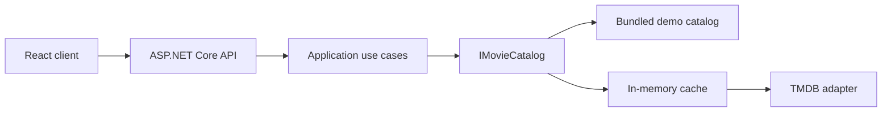

# Watch Compass

[](https://github.com/princ/watch-compass/actions/workflows/ci.yml)

[](LICENSE)

Watch Compass helps you find a film by title, genre, mood, and available time. The React client uses an ASP.NET Core API for browsing, regional provider information, similar titles, and a small, explainable recommendation shortlist.

## Try the demo — no API key

Prerequisites: .NET SDK **10.0.100** (or a compatible patch) and Node.js **24+**.

From the repository root:

```sh
dotnet run --project src/WatchCompass.Api --launch-profile Demo
```

In a second terminal:

```sh
cd frontend
npm ci
npm run dev
```

Open [localhost:5173](http://localhost:5173). The API runs at [localhost:5276](http://localhost:5276); its development [Swagger UI](http://localhost:5276/swagger) lists the endpoints.

The first run needs internet access to restore dependencies. Once installed, the demo uses only local services and bundled artwork. It does not require a TMDB account.

### A short walkthrough

1. Confirm the **Demo mode** notice. Open **The Last Stroopwafel** from a sample feed and inspect its details and similar titles.
2. Close details, change **Watch region** from Netherlands to United States, and reopen the film. Availability changes from **Canal Cinema (sample)** to **Evening Screen (sample)**.
3. Search for **the** to try title matching and pagination. Add release year **2024** to narrow it to four results.
4. Clear the title search and year, then browse **Comedy**. Its 13 films span two pages at the default page size.
5. With **Feel Good**, **120 minutes**, and no title hint or exclusions, select **Get recommendations**. Inspect the runtime and genre explanations. Try the other moods too.
6. Select **Scary** and avoid **Horror**: the shortlist is empty because those constraints conflict. Clear that exclusion before continuing.
7. Select **Spin for a pick** to open a random film from the currently loaded results.

### What the demo represents

The 24 films, posters, descriptions, and provider names are fictional examples. Trending and now-playing feeds are fixed selections, not current rankings or theatrical releases. NL, US, and GB have sample provider mappings; other supported regions return no availability. One film deliberately has no provider data.

The demo exercises the real HTTP endpoints and application use cases. Only the `IMovieCatalog` implementation changes. Search is a case-insensitive title substring match; ordering and similar-title links are fixed in the bundled dataset. Demo poster URLs are relative to the frontend origin, where the local SVG files are served.

## Run with live TMDB data

Use a TMDB v4 bearer token on the backend only. In PowerShell:

```powershell
$env:TMDB__ApiKey="<your_tmdb_v4_token>"
$env:Catalog__Mode="Tmdb"
dotnet run --project src/WatchCompass.Api --launch-profile http
```

Start the frontend as above. `Tmdb` is the default catalog mode and fails startup if its credentials are missing. `Demo` must be selected explicitly; an upstream failure never switches the app to sample data. Restart the backend and reload the frontend when changing modes.

The frontend defaults to `http://localhost:5276`. Set `VITE_API_BASE_URL` before starting Vite to use another API address.

## How recommendations work

| Mood | Required genre |
| --- | --- |
| Feel Good | Comedy |
| Chill | Drama |
| Intense | Thriller |
| Scary | Horror |

These mappings are deliberately simple heuristics. A genre cannot establish a film's emotional tone; for example, a drama may not feel relaxing.

Without a title hint, recommendations use genre discovery. With a hint, they search titles and still require the mapped genre. Actor searches are not supported. The service evaluates at most the first 20 candidates, preserves catalog order, and returns up to three whose verified runtime fits the budget and whose genres do not overlap the exclusions. The release-year filter applies to both candidate sources.

Missing runtime or genre information triggers a details lookup. Candidates with unverifiable constraints are omitted. Provider lookup failures leave an otherwise valid recommendation available without provider badges. An empty shortlist means no eligible candidate was found within the bounded search, not that the entire catalog has no match. Explanations describe the actual genre rule and runtime.

## Architecture and tradeoffs



- **Contracts** define API DTOs; the TypeScript client mirrors their shape.
- **Application** owns use cases and the catalog interface; **Domain** contains mood and time-budget types.
- **Infrastructure** implements the demo catalog, TMDB integration, and cache decorator. Demo reads do not need caching or HTTP resilience.
- **API** handles validation, sanitized problem responses, configuration, CORS, logging, and telemetry.
- **Frontend** keeps request state in feature hooks and composes browse, recommendations, and details in `App.tsx`.

The existing catalog interface lets the demo reuse application behavior without frontend response mocks or a second recommendation engine. There is no database or authentication; those are outside this project's movie-discovery focus.

TMDB calls use `HttpClientFactory`, cancellation, timeouts, exponential retry backoff with optional jitter, and separate in-memory cache TTLs. The cache suits a single instance; it does not coordinate multiple deployments. Serilog, OpenTelemetry, `/health`, and `/metrics` provide operational entry points; `/health` is a liveness probe, not a TMDB readiness check.

## Configuration

| Setting | Purpose |
| --- | --- |
| `Catalog__Mode` | `Tmdb` (default) or `Demo`; other values fail startup. |
| `TMDB__ApiKey` | TMDB v4 bearer token; required only in live mode. |
| `TMDB__BaseUrl` | Defaults to `https://api.themoviedb.org/3`. |
| `TMDB__DefaultCountryCode` | Live catalog fallback region, `US`. The UI explicitly sends `NL` by default. |
| `TMDB__Language` | Defaults to `en-US`. |
| `TMDB__RequestTimeoutSeconds` | Per-attempt timeout. |
| `TMDB__MaxRetries` | Retry count for transient upstream failures. |
| `TMDB__BackoffBaseMilliseconds` | Exponential retry backoff base. |
| `TMDB__BackoffJitterMilliseconds` | Enables jitter when greater than zero; not a fixed jitter duration. |
| `Caching__MovieCatalog__*Minutes` | Live catalog TTLs; `0` disables that cache slice. |
| `Cors__AllowedOrigins__0` | Allowed frontend origin. |

## Quality gates

```sh
dotnet test
```

In `frontend`:

```sh
npm ci
npm run lint
npm test
npm run build
```

Unit tests cover catalog behavior, cache behavior, configuration, and recommendation constraints. Integration tests exercise the live adapter with local WireMock fixtures and the complete API with the bundled demo catalog. Demo integration tests reject outbound HTTP requests. Frontend tests cover interactions, stale requests, demo labeling, and metadata recovery.

CI builds and tests both applications and runs dependency advisory checks. Tests do not require a live TMDB key. Do the walkthrough above against the running API before releasing changes to the demo flow.

## API surface

- `GET /api/app-info` — `{ "catalogMode": "demo" | "tmdb" }`, reported by the backend.
- `GET /api/genres` — genre names.
- `GET /api/movies/search?query=...&page=1&pageSize=12&releaseYear=2024` — title search.
- `GET /api/movies/discover?genre=Comedy&page=1&pageSize=12&releaseYear=2024` — genre discovery.
- `GET /api/movies/trending?limit=12` and `GET /api/movies/now-playing?limit=12` — feeds, maximum limit 20.
- `GET /api/movies/{movieId}?countryCode=NL` — details and regional availability.
- `GET /api/movies/{movieId}/similar` — similar titles.
- `POST /api/recommendations` — mood, runtime, region, optional title/year, and genre exclusions.
- `GET /health` and `GET /metrics` — liveness and Prometheus metrics.

Invalid constraints return RFC 7807 `400` responses. Invalid upstream payloads return sanitized `502` responses; exhausted upstream retries and timeouts return sanitized `503` responses. Problem responses include a trace identifier for log correlation.

## Known follow-ups

- The details drawer handles Escape and restores focus, but still needs focus containment and background keyboard isolation to complete its modal accessibility behavior.
- `App.tsx` still contains substantial form and page markup. Extract the recommendation form and browse sections as cohesive components when working on those areas next.

## Credits

Demo content and SVG artwork are original fictional examples included under this repository's MIT license.

Live movie data and artwork are supplied by [The Movie Database (TMDB)](https://www.themoviedb.org).
This product uses the TMDB API but is not endorsed or certified by TMDB.
